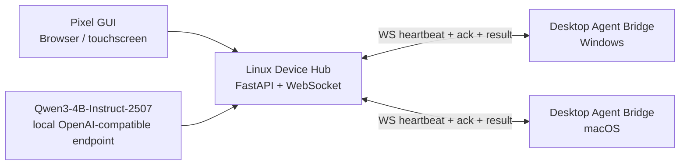

# Pocket Vibe Agent Demo

面向“便携 Linux 小电脑 + Windows/Mac 桌面 Agent”的最小可运行雏形。

这个 demo 做了三件事：

- 在 Linux 小电脑侧运行一个 **Device Hub**：提供像素风 GUI、Qwen 决策接口、Agent 注册与调度。
- 在 Windows/Mac 侧运行一个 **Desktop Agent Bridge**：主动连接 Device Hub，接收任务并返回 ACK/结果。
- 在通信协议里内置 **WebSocket 长连接、心跳、消息 ID、ACK、重连退避、事件日志**，方便后续替换为真实多 agent 控制器。

## 快速启动

> Windows PowerShell / macOS / Linux 都可以跑。Python 建议 3.10+。

```bash
cd S:/portable-vibe-agent-demo
python -m venv .venv
.venv/Scripts/python -m pip install -r requirements.txt
.venv/Scripts/python device/device_hub.py
```

打开浏览器：

```text
http://127.0.0.1:8787
```

再开一个终端启动桌面 Agent：

```bash
cd S:/portable-vibe-agent-demo
.venv/Scripts/python device/desktop_agent.py --hub ws://127.0.0.1:8787/ws/desktop --token dev-token
```

如果要把任务转交给这台电脑上的本地 agent，使用 local agent adapter：

```bash
cd S:/portable-vibe-agent-demo
.venv/Scripts/python device/desktop_agent.py --hub ws://127.0.0.1:8787/ws/desktop --token dev-token --agent-id local-windows --local-agent-config configs/local_agent.example.json
```

`configs/local_agent.example.json` 里的 `command` 决定真正调用哪个本机 agent。默认示例只调用 `examples/local_agent_echo.py`，不会执行任意 shell。详细说明见 `docs/LOCAL_AGENT_BRIDGE.md`。

如果要接本机 Codex CLI，使用 Codex bridge：

```bash
cd S:/portable-vibe-agent-demo
.venv/Scripts/python device/desktop_agent.py --hub ws://127.0.0.1:8787/ws/desktop --token dev-token --agent-id codex-worker --local-agent-config configs/codex_cli.example.json
```

`configs/codex_cli.example.json` 默认真实执行 `codex exec`；如果只想验证链路，请在配置命令中临时加入 `--dry-run`。详细说明见 `docs/CODEX_BRIDGE.md`。

macOS / Linux 虚拟环境路径换成：

```bash
source .venv/bin/activate
python device/device_hub.py
python device/desktop_agent.py --hub ws://127.0.0.1:8787/ws/desktop --token dev-token
```

## Qwen 接入方式

默认情况下，demo 使用本地启发式决策器，便于无模型环境直接跑通。

如果你的 Linux 小电脑上已经用 vLLM / SGLang / llama.cpp 等方式暴露了 OpenAI-compatible 接口，可以设置：

```bash
set QWEN_BASE_URL=http://127.0.0.1:8000/v1
set QWEN_API_KEY=local-not-needed
set QWEN_MODEL=Qwen/Qwen3-4B-Instruct-2507
```

macOS / Linux：

```bash
export QWEN_BASE_URL=http://127.0.0.1:8000/v1
export QWEN_API_KEY=local-not-needed
export QWEN_MODEL=Qwen/Qwen3-4B-Instruct-2507
```

Device Hub 会优先调用 Qwen；失败时自动回退到启发式决策，确保 demo 不会因为模型服务未启动而断掉。

## 通信结构



## 稳定通信策略

- Desktop Agent 使用主动外连，适合局域网、热点、USB 网络共享等场景。
- 每条任务都有 `msg_id` / `task_id`，Agent 先回 `ack`，执行后回 `result`。
- 双端都有心跳；Agent 断开后指数退避重连。
- Device Hub 将事件写入 `runtime/events.jsonl`，方便调试和后续做断点恢复。
- 默认 Agent 是安全 demo 模式：只返回系统信息和模拟结果，不执行任意 shell。

## 文件结构

```text
device/device_hub.py       Linux 小电脑侧 Hub + GUI 静态资源服务
device/desktop_agent.py    Windows/Mac 侧 Agent Bridge
device/qwen_router.py      Qwen 决策器，支持真实模型与启发式回退
device/protocol.py         协议消息、ID、时间戳
web/index.html             像素风 GUI
web/styles.css             像素风样式
web/app.js                 GUI WebSocket 和任务操作逻辑
docs/ARCHITECTURE.md       产品雏形设计说明
```

## 下一步建议

1. 把 `desktop_agent.py` 的 demo executor 替换成真实 Codex / Claude Code / 本地 IDE agent 的受控 API。
2. 把任务队列从内存升级到 SQLite，做严格断点续传。
3. 给每个桌面 Agent 加能力声明：`shell`、`repo_read`、`repo_write`、`browser`、`git`、`approval_required`。
4. 将 Qwen 决策输出固定成 JSON schema，避免自然语言漂移。
5. 增加 mTLS 或 WireGuard/Tailscale，解决跨网络和身份认证问题。
